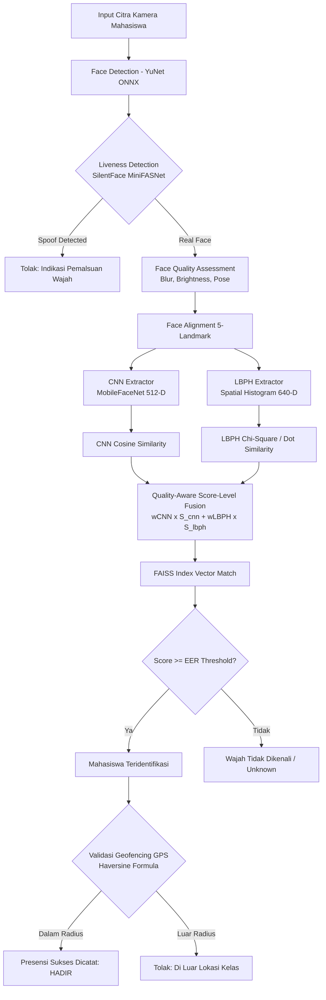

<div align="center">

# 🎓 Hybrid Face Attendance System
### Sistem Presensi Cerdas Berbasis Hybrid LBPH & Deep Learning CNN dengan Anti-Spoofing & Geofencing

[](https://fastapi.tiangolo.com)
[](https://www.python.org/)
[](https://pytorch.org/)
[](https://opencv.org/)
[](https://react.dev/)
[](https://expo.dev/)
[](https://www.mysql.com/)

<p align="center">
  <b>Solusi presensi mahasiswa otomatis berskala enterprise yang mengombinasikan akurasi deep feature CNN (MobileFaceNet), efisiensi tekstural lokal LBPH, proteksi liveness Silent-Face, serta validasi geolokasi GPS presisi tinggi.</b>
</p>

[Fitur Utama](#-fitur-utama) •
[Arsitektur Pipeline](#-arsitektur-pipeline-hybrid) •
[Struktur Proyek](#-struktur-direktori) •
[Panduan Instalasi](#-panduan-instalasi-lengkap) •
[Konfigurasi Environment](#-konfigurasi-environment) •
[Keamanan & Privasi](#-keamanan--privasi-biometrik)

---

</div>

## 📌 Sekilas Proyek

Repositori ini mengimplementasikan **sistem presensi multi-tier** terintegrasi yang dirancang untuk mengatasi tantangan presensi perkuliahan konvensional (titip absen, manipulasi lokasi, dan pemalsuan foto/spoofing). Sistem terdiri dari tiga komponen utama:

1. **Backend Engine (FastAPI + SQLAlchemy 2.0)**: Menyediakan RESTful API berkinerja tinggi, manajemen data akademik, pipeline pengenalan wajah multi-tier (YuNet, MobileFaceNet, LBPH, FAISS), serta verifikasi geolokasi.
2. **Web Admin Dashboard (React 19 + Vite + Tailwind CSS)**: Portal manajemen untuk Admin dan Dosen guna mengelola master data (prodi, mata kuliah, dosen, mahasiswa, jadwal, kelas), monitoring presensi real-time, setup geolokasi berbasis peta Leaflet, serta ekspor laporan.
3. **Mobile Client (React Native + Expo SDK 54)**: Aplikasi mobile bagi mahasiswa untuk melakukan presensi mandiri dengan kamera selfie (liveness check) dan geolokasi GPS real-time.

---

## ✨ Fitur Utama

### 🧠 1. Hybrid Face Recognition Engine (Quality-Aware Score Fusion)
- **Face Detection & Alignment**: YuNet ONNX (99.5% accuracy) dengan 5 facial landmarks alignment.
- **Dual Feature Extraction**:
  - **CNN Feature**: MobileFaceNet (512-D deep embedding).
  - **Textural Feature**: Multi-scale Local Binary Pattern Histograms / LBPH (640-D spatial histogram).
- **Quality-Aware Fusion**: Adaptasi bobot dinamis berdasarkan penilaian kualitas citra (*blur*, *brightness*, dan *pose angle*):
  $$\text{Final Score} = w_{\text{CNN}} \cdot S_{\text{CNN}} + w_{\text{LBPH}} \cdot S_{\text{LBPH}}$$
- **Fast Similarity Search**: FAISS (*Facebook AI Similarity Search*) Vector Index untuk pencarian kandidat berkecepatan milidetik pada galeri mahasiswa.

### 🛡️ 2. Anti-Spoofing & Liveness Detection
- Mengintegrasikan **Silent-Face-Anti-Spoofing (MiniFASNet)** berbasis PyTorch untuk mendeteksi serangan presentasi:
  - Serangan cetak foto (print attack)
  - Pemutaran layar HP/monitor (replay attack)
  - Topeng 3D (3D mask attack)

### 📍 3. Validasi Geolokasi & Geofencing (Anti-Fake GPS)
- Validasi jarak radius menggunakan rumus **Haversine**:
  - Dosen menentukan titik koordinat latitude/longitude dan radius toleransi (meter).
  - Mahasiswa wajib berada di dalam radius kelas saat melakukan presensi.
  - Logging status presensi: `Hadir`, `Terlambat`, `Di Luar Radius`, `Wajah Tidak Cocok`.

### 📊 4. Manajemen Akademik & Portal Lengkap
- Manajemen hierarki akademik: Prodi $\rightarrow$ Angkatan $\rightarrow$ Golongan $\rightarrow$ Kelas $\rightarrow$ Mahasiswa $\rightarrow$ Dosen $\rightarrow$ Jadwal Perkuliahan & Pertemuan.
- Role-based Access Control (Admin, Dosen, Mahasiswa).
- Ekspor rekap presensi ke format Excel (`.xlsx`).

---

## 🏗 Arsitektur Pipeline Hybrid

Berikut adalah alur pengolahan citra pada backend `ModelBaru/`:



---

## 📁 Struktur Direktori

```plaintext
hybrid-face-attendance-lbph-cnn/
├── backend/                        # REST API FastAPI & Core Application
│   ├── app/                        # Modul aplikasi (routes, models, schemas, config)
│   ├── .env.example                # Template konfigurasi environment backend
│   ├── init_db.py                  # Inisialisasi skema 20 tabel database SQLAlchemy
│   ├── seed.py                     # Pembuat akun admin pertama secara interaktif
│   ├── requirements.txt            # Dependensi Python backend & ML
│   └── migrate_*.py                # Skrip migrasi skema tabel historis
│
├── Website/                        # Dashboard Admin & Dosen (React 19 + Vite)
│   ├── src/                        # Halaman, komponen, service API, router
│   ├── public/                     # Aset statis website
│   ├── .env.example                # Konfigurasi endpoint API frontend
│   └── package.json                # Dependensi Node.js frontend web
│
├── AndroidFolder/                  # Aplikasi Mobile Mahasiswa (React Native Expo)
│   ├── app/                        # Halaman berbasis file-routing Expo Router
│   ├── components/                 # Komponen UI mobile & integrasi kamera
│   ├── .env.example                # Konfigurasi endpoint API mobile
│   └── package.json                # Dependensi Expo SDK 54
│
├── ModelBaru/                      # Pipeline Machine Learning & Computer Vision
│   ├── models/                     # Bobot model YuNet & MobileFaceNet (ONNX)
│   ├── resources/                  # Bobot model Anti-Spoofing PyTorch (.pth)
│   ├── enhanced_system.py          # Implementasi Quality-Aware Score Fusion
│   ├── anti_spoof_manager.py       # Wrapper inferensi liveness detection
│   ├── faiss_gallery.py            # Indeks FAISS pencarian kemiripan vektor
│   ├── calibrate_threshold.py      # Kalibrasi threshold ROC & Equal Error Rate (EER)
│   └── face_preprocessing.py       # Normalisasi, alignment, dan augmentasi citra
│
└── SilentFaceAntiSpoofing/         # Referensi algoritma MiniFASNet & lisensi asli
```

---

## 💻 Prasyarat Sistem

Pastikan perangkat Anda telah memenuhi spesifikasi perangkat lunak berikut:

| Komponen | Versi yang Didukung | Keterangan |
| :--- | :--- | :--- |
| **Python** | `3.10.x` atau `3.11.x` | Diperlukan karena batasan kompatibilitas TensorFlow & ONNX |
| **Node.js** | `v20.19+` atau `v22.12+` | Runtime untuk Web Vite dan Expo Mobile |
| **MySQL** | `8.0+` | Basis data relasional dengan encoding `utf8mb4` |
| **C++ Build Tools** | MSVC v143+ (Windows) | Diperlukan jika paket C/C++ dikompilasi saat instalasi |
| **Android Studio & JDK** | JDK 17 (LTS) | Diperlukan jika ingin melakukan build Android APK native |

---

## 🚀 Panduan Instalasi Lengkap

### Langkah 1: Persiapan Database MySQL

Buka terminal MySQL atau phpMyAdmin, lalu buat database dan pengguna khusus:

```sql
CREATE DATABASE skripsi_presensi CHARACTER SET utf8mb4 COLLATE utf8mb4_unicode_ci;
CREATE USER 'presensi_app'@'localhost' IDENTIFIED BY 'GANTI_PASSWORD_DATABASE';
GRANT ALL PRIVILEGES ON skripsi_presensi.* TO 'presensi_app'@'localhost';
FLUSH PRIVILEGES;
```

---

### Langkah 2: Setup Backend (FastAPI)

1. Masuk ke direktori `backend/` dan siapkan Virtual Environment:
   ```powershell
   cd backend
   py -3.11 -m venv venv
   .\venv\Scripts\Activate.ps1
   ```

2. Perbarui pip dan pasang semua dependensi:
   ```powershell
   python -m pip install --upgrade pip
   pip install -r requirements.txt
   ```

   > [!TIP]
   > Jika PyTorch CPU diperlukan secara terpisah:
   > ```powershell
   > pip install torch torchvision --index-url https://download.pytorch.org/whl/cpu
   > ```

3. Salin konfigurasi environment dan buat `SECRET_KEY` acak:
   ```powershell
   Copy-Item .env.example .env
   python -c "import secrets; print(secrets.token_hex(32))"
   ```
   *Buka file `.env` dan masukkan hasil generator tadi ke `SECRET_KEY`, serta sesuaikan kredensial MySQL Anda.*

4. Inisialisasi tabel database dan buat akun Admin:
   ```powershell
   python init_db.py
   python seed.py
   ```
   *(Skrip `seed.py` akan meminta Nama, Email, dan Password Admin secara interaktif)*

5. Jalankan server backend:
   ```powershell
   uvicorn app.main:app --host 0.0.0.0 --port 8000 --reload
   ```

   - **API Docs (Swagger UI)**: [http://localhost:8000/api/docs](http://localhost:8000/api/docs)
   - **Health Check**: [http://localhost:8000/api/health](http://localhost:8000/api/health)

---

### Langkah 3: Setup Website Admin (React + Vite)

Buka terminal baru dari root proyek:

```powershell
cd Website
npm ci
Copy-Item .env.example .env
npm run dev
```

- Buka URL lokal yang muncul pada terminal (biasanya `http://localhost:5173`).
- File `.env` pada `Website` mengarahkan ke:
  ```env
  VITE_API_BASE_URL=http://localhost:8000/api/v1
  ```
- Untuk membuat build produksi:
  ```powershell
  npm run build
  ```

---

### Langkah 4: Setup Aplikasi Mobile (Expo / Android)

Buka terminal baru dari root proyek:

```powershell
cd AndroidFolder
npm ci
Copy-Item .env.example .env
npm start
```

#### Pengaturan Alamat API Mobile (`AndroidFolder/.env`):
- **Emulator Android Studio**:
  ```env
  EXPO_PUBLIC_API_URL=http://10.0.2.2:8000
  ```
- **Perangkat Fisik (Smartphone via Expo Go / APK)**:
  ```env
  EXPO_PUBLIC_API_URL=http://<IP_LAN_KOMPUTER_ANDA>:8000
  ```
  *(Pastikan HP dan komputer berada di jaringan Wi-Fi yang sama dan firewall port 8000 terbuka).*

---

## ⚙️ Konfigurasi Environment

### Backend (`backend/.env`)

| Variabel | Deskripsi | Default / Rekomendasi |
| :--- | :--- | :--- |
| `DB_HOST` | Host server database MySQL | `localhost` |
| `DB_PORT` | Port server MySQL | `3306` |
| `DB_USER` | Username pengguna database | `presensi_app` |
| `DB_PASSWORD` | Password pengguna database | *Kustom* |
| `DB_NAME` | Nama database | `skripsi_presensi` |
| `SECRET_KEY` | Kunci enkripsi token JWT (min. 32 char) | *Hasil `secrets.token_hex(32)`* |
| `ALGORITHM` | Algoritma enkripsi JWT | `HS256` |
| `ACCESS_TOKEN_EXPIRE_MINUTES` | Masa kedaluwarsa akses token (menit) | `60` |
| `DEBUG` | Mode debug backend FastAPI | `false` |
| `FACE_MODEL_TYPE` | Pipeline inferensi model wajah | `enhanced` |
| `PRELOAD_ML_MODEL` | Muat model ML ke RAM saat startup server | `false` (hemat RAM) / `true` |
| `UPLOAD_DIR` | Folder penyimpanan unggahan sementara | `uploads` |
| `DATASET_DIR` | Folder penyimpanan foto dataset | `datasets` |

---

## 🧠 Model Weights & Kalibrasi Biometrik

Bobot model deep learning dasar telah tersimpan secara modular di:
- `ModelBaru/models/face_detection_yunet_2023mar.onnx` *(Model deteksi YuNet)*
- `ModelBaru/models/mobilefacenet.onnx` *(Model ekstraksi fitur embedding wajah)*
- `ModelBaru/resources/anti_spoof_models/*.pth` *(Model liveness detection 2.7_80x80 & 4_0_0_80x80)*

> [!NOTE]
> - Model dasar di atas merupakan arsitektur general dan **bebas dari data identitas wajah siapapun**.
> - Setelah sistem berjalan, lakukan **Enrollment Mahasiswa** melalui Web Admin. File indeks FAISS (`face_metadata.pkl`) dan folder foto galeri akan dibentuk secara dinamis dan diabaikan oleh Git secara otomatis demi keamanan privasi.

---

## 🔒 Keamanan & Privasi Biometrik

Repositori ini telah dikonfigurasi mengikuti standar keamanan pengembangan perangkat lunak:
- **Zero Sensitive Data in Git**: File `.env`, data mahasiswa, foto enrollment wajah, database dumps, dan token autentikasi diabaikan secara ketat melalui `.gitignore`.
- **Stateless Biometric Hashing**: Foto wajah saat proses presensi real-time hanya diproses di memory untuk ekstraksi fitur dan tidak disimpan sembarangan tanpa otorisasi.
- **Production Build Hardening**: Sebelum melakukan deployment ke server produksi:
  1. Ubah `DEBUG=false` pada backend.
  2. Gunakan HTTPS (SSL/TLS) dan reverse proxy seperti NGINX.
  3. Ganti debug keystore Android dengan release keystore resmi.

---

## 📄 Lisensi & Atribusi

Proyek ini dikembangkan untuk kebutuhan riset, skripsi, dan implementasi sistem presensi akademik.
- **YuNet**: OpenCV Zoo (Apache-2.0 License).
- **Silent-Face-Anti-Spoofing**: Minivision Technology (Apache-2.0 License).
- Komponen kode backend, web frontend, dan aplikasi mobile dilisensikan di bawah **MIT License**.

<div align="center">
  <sub>Dibuat dengan dedikasi untuk integrasi Computer Vision & Mobile Computing yang andal.</sub>
</div>
